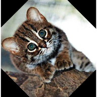
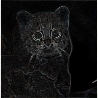
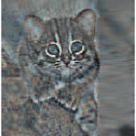
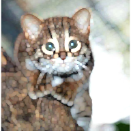
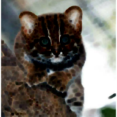
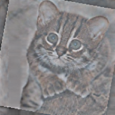
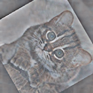
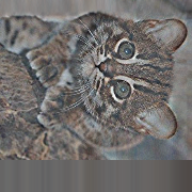
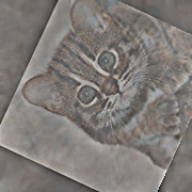

# Functionality of the OpenImageR package

The following notes and examples illustrate the image processing
functions of the OpenImageR package.

## Basic functions

#### readImage

The *readImage* function reads images from a variety of types such as
‘png’, ‘jpeg’, ‘jpg’ or ‘tiff’,

``` r

library(OpenImageR)

path = file.path(getwd(), 'vignette_1', 'image1.jpeg')

im = readImage(path)
dim(im)
```

    ## [1] 496 487   3

  

#### imageShow

The *imageShow* function utilizes either a shiny application (if the
image is a character path) or the grid.raster function of the base grid
package (if the image is a 2- or 3-dimensional object where the third
dimension is equal to 3) to display images,  
  

``` r

imageShow(im)
```

  
  

#### writeImage

The *writeImage* function writes a 2- or 3-dimensional object (matrix,
data frame or array where the third dimension is equal to 3) in a user
specified image format. The supported types are .png, .jpeg, .jpg,
.tiff.  
  

``` r

writeImage(im, file_name = 'my_image.jpeg')
```

  

#### rgb_2gray

To convert an image from RGB to gray one can use the *rgb_2gray*
function, which takes a single argument (matrix, data frame or array),  
  

``` r

path = file.path(getwd(), 'vignette_1', 'image2.jpg')

im = readImage(path)

imageShow(im)
```

  

``` r

r2g = rgb_2gray(im)

imageShow(r2g)
```

  
  

#### cropImage

The *cropImage* function reduces the size of the image horizontally and
vertically. The function takes four arguments : *image* (2- or
3-dimensional object where the third dimension is equal to 3),
*new_width* (the desired new width), *new_height* (the desired new
height) and *type*. While the type *‘equal_spaced’* crops the image
equally in both directions (horizontal, vertical) towards the center of
the image, the type *‘user_defined’* allows the user to specify which
regions of the image should be kept  
  

``` r

eq_sp = cropImage(im, new_width = 200, new_height = 200, type = 'equal_spaced')

imageShow(eq_sp)
```

  

``` r

us_def = cropImage(im, new_width = 20:225, new_height = 5:185, type = 'user_defined')

imageShow(us_def)
```

  
  

#### flipImage

A [flipped image](https://en.wikipedia.org/wiki/Flipped_image) (or
reversed image) is a static or moving image that is generated by a
mirror-reversal of an original across a horizontal axis (a flopped image
is mirrored across the vertical axis). The first image shows the
original image and the second one a horizontal flip,  
  

``` r

path = file.path(getwd(), 'vignette_1', 'image1.jpeg')

im = readImage(path)

imageShow(im)
```

  
  

``` r

flp_vert = flipImage(im, mode = 'horizontal')

imageShow(flp_vert)
```

  
  

#### rotateFixed

The *rotateFixed* function rotates an image by specific angles (90, 180,
270). I added this function (besides the *rotateImage* function) in the
package, because it takes less time to return the output,  
  

``` r

r270 = rotateFixed(im, 270)

imageShow(r270)
```

  
  

#### rotateImage

The *rotateImage* function is more flexible in comparison to the
*rotateFixed* function. It allows the user to rotate an image by a
specific angle (between 0 and 360 degrees) using either the ‘nearest’ or
the ‘bilinear’ interpolation method,  
  

``` r

r45 = rotateImage(im, 45, threads = 1)

imageShow(r45)
```

  
  

#### resizeImage

The *resizeImage* function takes advantage of two different
interpolation methods ( nearest neighbors, bilinear ) to either down- or
upsample an image,  
  

``` r

path = file.path(getwd(), 'vignette_1', 'image2.jpg')

im = readImage(path)

intBl = resizeImage(im, width = 100, height = 100, method = 'bilinear', normalize_pixels = TRUE)

imageShow(intBl)
```

  
  

It is known that resizing an image using bilinear interpolation gives
better results, however the nearest neighbors method is faster.  

A further option to resize an image is by using *gaussian_blur* (
down-sampling gives better results than up-sampling that’s why is the
only option in the OpenImageR package ),  

``` r

intGbl = down_sample_image(im, factor = 2.5, gaussian_blur = T)

imageShow(intGbl)
```

  

The factor of the function applies equally to the horizontal and
vertical dimensions of the image.  
  

#### translation

**translation** is the shifting of an object’s location by
adding/subtracting a value to/from the X or Y coordinates,

``` r

tr = translation(im, shift_rows = 50, shift_cols = -50)

imageShow(tr)
```

  

## Image filtering

#### edge_detection

According to Wikipedia, edge detection is the name for a set of
mathematical methods which aim at identifying points in a digital image
at which the image brightness changes sharply or, more formally, has
discontinuities. The *edge_detection* function uses one of the
*Frei_chen*, *LoG (Laplacian of Gaussian)*, *Prewitt*, *Roberts_cross*,
*Scharr* or *Sobel* filters to perform edge detection,  

``` r

path = file.path(getwd(), 'vignette_1', 'image1.jpeg')

im = readImage(path)

edsc = edge_detection(im, method = 'Scharr', conv_mode = 'same')

imageShow(edsc)
```

  

#### uniform_filter

In a *uniform filter* all the values within the filter (kernel) have the
same weight,

``` r

kernel_size =  c(4,4)

unf = uniform_filter(im, size = kernel_size, conv_mode = 'same')

unif_filt = matrix(1, ncol = kernel_size[1], nrow = kernel_size[2])/(kernel_size[1] * kernel_size[2])
unif_filt
```

    ##        [,1]   [,2]   [,3]   [,4]
    ## [1,] 0.0625 0.0625 0.0625 0.0625
    ## [2,] 0.0625 0.0625 0.0625 0.0625
    ## [3,] 0.0625 0.0625 0.0625 0.0625
    ## [4,] 0.0625 0.0625 0.0625 0.0625

  
  

#### image_thresholding

According to Wikipedia, *thresholding* is the simplest method of image
segmentation. From a grayscale image, thresholding can be used to create
binary images,

``` r

path = file.path(getwd(), 'vignette_1', 'image2.jpg')

im = readImage(path)

thr = image_thresholding(im, thresh = 0.5)           # if the input image is 3-dimensional it will be converted internally to a matrix

imageShow(thr)
```

  
  

#### gamma_correction

*Gamma correction*, or often simply gamma, is the name of a nonlinear
operation used to encode and decode luminance or tristimulus values in
video or still image systems (Wikipedia),

``` r

gcor = gamma_correction(im, gamma = 2)        # show image with gamma correction 

imageShow(gcor)
```

  
  

#### ZCAwhiten

[**Whitening** (or
sphering)](http://ufldl.stanford.edu/tutorial/unsupervised/PCAWhitening)
is the preprocessing needed for some algorithms. If we are training on
images, the raw input is redundant, since adjacent pixel values are
highly correlated. The purpose of whitening is to reduce the correlation
between features and to return features with the same variance,

``` r

res = ZCAwhiten(im, k = 20, epsilon = 0.1)

imageShow(res)
```

  
  

#### dilationErosion

[**Dilation** and
**erosion**](https://www.mathworks.com/help/images/morphological-dilation-and-erosion.html)
are the most basic morphological operations. Dilation adds pixels to the
boundaries of objects in an image, while erosion removes pixels on
object boundaries,

``` r

res_delate = dilationErosion(im, Filter = c(8,8), method = 'dilation')

imageShow(res_delate)
```

  
  

``` r

res_erosion = dilationErosion(im, Filter = c(8,8), method = 'erosion')

imageShow(res_erosion)
```

  
  

#### Augmentation

Augmentations are specific transformations applied to an image. The
**Augmentation** function allows the user to *flip*, *crop*, *resize*,
*shift*, *rotate*, *zca-whiten* and *threshold* an image. It either
returns a single image,

``` r

path = file.path(getwd(), 'vignette_1', 'image1.jpeg')

im = readImage(path)

dim(im)
```

    ## [1] 496 487   3

``` r

augm = Augmentation(im, flip_mode = 'horizontal', crop_width = 20:460, crop_height = 30:450, 
                    
                    resiz_width = 180, resiz_height = 180, resiz_method = 'bilinear', 
                    
                    shift_rows = 0, shift_cols = 0, rotate_angle = 350, 
                    
                    rotate_method = 'bilinear', zca_comps = 100, 
                    
                    zca_epsilon = 0.1, image_thresh = 0.0, verbose = T)
```

    ## 
    ## time to complete : 0.02446651 secs

``` r

imageShow(augm)
```

  
  

or multiple transformed images using either pre-specified or random
parameters (here I utilized the lapply function),

``` r

# random rotations
samp_rot = sample(c(seq(5, 90, 30), seq(270, 350, 30)), 3, replace = F)

# random shift of rows
samp_shif_rows = sample(seq(-50, 50, 10), 3, replace = F)

# random shift of columns
samp_shif_cols = sample(seq(-50, 50, 10), 3, replace = F)


res = lapply(1:length(samp_rot), function(x) 
  
  Augmentation(im, flip_mode = 'horizontal', crop_width = 20:460, crop_height = 30:450, 
               
               resiz_width = 180, resiz_height = 180, resiz_method = 'bilinear', 
                    
               shift_rows = samp_shif_rows[x], shift_cols = samp_shif_cols[x], 
               
               rotate_angle = samp_rot[x], rotate_method = 'bilinear', zca_comps = 100, 
              
               zca_epsilon = 0.1, image_thresh = 0.0, verbose = F))


print(length(res))
```

    ## [1] 3

``` r

imageShow(res[[1]])
```

  
  

``` r

imageShow(res[[2]])
```

  
  

``` r

imageShow(res[[3]])
```

  
  

## Image recognition

#### HOG ( histogram of oriented gradients )

The histogram of oriented gradients (HOG) is a feature descriptor used
in computer vision and image processing for the purpose of object
detection. The technique counts occurrences of gradient orientation in
localized portions of an image. This method is similar to that of edge
orientation histograms, scale-invariant feature transform descriptors,
and shape contexts, but differs in that it is computed on a dense grid
of uniformly spaced cells and uses overlapping local contrast
normalization for improved accuracy (Wikipedia).  

The *HOG* function of the OpenImageR package is a modification and
extention of the
[findHOGFeatures](https://github.com/lastlegion/SimpleCV/blob/develop/SimpleCV/ImageClass.py)
function ( SimpleCV computer vision platform ), please, consult the
COPYRIGHT file.  
  

The purpose of the function is to create a vector of HOG descriptors,
which can be used in classification tasks. It takes either RGB (they
will be converted to gray) or gray images as input,

``` r

path = file.path(getwd(), 'vignette_1', 'image2.jpg')

image = readImage(path)

image = image * 255

hog = HOG(image, cells = 3, orientations = 6)
hog
```

    ##  [1] 0.77467384 1.14086398 2.31882081 1.23274428 2.11970154 2.18883489
    ##  [7] 0.98549496 2.01821812 1.45391358 1.57411171 1.30782294 1.46338406
    ## [13] 2.02594883 1.34298808 0.67503592 2.00982150 1.17643072 0.45404311
    ## [19] 1.88299504 0.84538174 0.91915237 1.57228604 1.63834997 0.71412237
    ## [25] 1.02929321 2.34486369 1.87591134 1.29050657 3.25947824 1.45813862
    ## [31] 0.72216189 1.31668291 2.10979527 0.69908412 0.44783304 1.65000416
    ## [37] 0.47910579 0.43018401 0.30561757 0.15398813 0.88550213 0.25647707
    ## [43] 0.49130379 0.29065789 0.17552517 0.09544067 0.25962132 0.48733020
    ## [49] 0.52154428 0.61910760 0.03944711 0.05271813 0.04068158 0.15660130

  

#### HOG_apply

The *HOG_apply* function uses the previous mentioned HOG function to
return the HOG-descriptors for the following objects :

- a **matrix** of images such as the mnist data set, where each row
  represents a different digit (28 x 28 image)
- an **array**, where each slice represents a different image
- a **folder of images** where each file is a different image

In the following code chunk I’ll apply the HOG function to an array of
images. The result is a matrix, where each row respresents the
HOG-descriptors for each array slice (image),

``` r

path_im1 = file.path(getwd(), 'vignette_1', 'image1.jpeg')
path_im2 = file.path(getwd(), 'vignette_1', 'image2.jpg')

tmp_im1 = readImage(path_im1)
tmp_im2 = readImage(path_im2)

tmp_im1 = resizeImage(tmp_im1, 200, 200, normalize_pixels = TRUE)
tmp_im2 = resizeImage(tmp_im2, 200, 200, normalize_pixels = TRUE)

tmp_gray1 = rgb_2gray(tmp_im1)
tmp_gray2 = rgb_2gray(tmp_im2)
dim(tmp_gray2)
```

    ## [1] 200 200

``` r

tmp_arr = array(0, c(nrow(tmp_gray1), ncol(tmp_gray1), 2))
tmp_arr[,,1] = tmp_gray1
tmp_arr[,,2] = tmp_gray2

res = HOG_apply(tmp_arr, cells = 2, orientations = 3)
```

    ## 
    ## time to complete : 0.005757093 secs

``` r

res
```

    ##            [,1]       [,2]       [,3]       [,4]       [,5]       [,6]
    ## [1,] 0.03567210 0.04184320 0.04697102 0.04114384 0.04251350 0.04071912
    ## [2,] 0.02516962 0.03987394 0.03332250 0.02758259 0.03319461 0.02110433
    ##            [,7]       [,8]       [,9]      [,10]      [,11]      [,12]
    ## [1,] 0.03388292 0.03949191 0.04160370 0.03473255 0.02948566 0.02148235
    ## [2,] 0.01305696 0.01017814 0.01469827 0.01643285 0.01040454 0.01431658

### [image hashing](https://www.hackerfactor.com/blog/?/archives/432-Looks-Like-It.html)

The image hashing functions (*average_hash*, *dhash*, *phash*,
*invariant_hash*, *hash_apply*) of the OpenImageR package are
implemented in the way **perceptual hashing** works. Perceptual hashing
is the use of an algorithm that produces a fingerprint of images (in
OpenImageR those fingerprints are *binary features* or *hexadecimal
hashes*). The difference between cryptographic and image hashing is that
the latter tries to find similar and not exact matches. In cryptographic
hashing small differences of the hashes lead to entirely different
output, which is not the case for perceptual hashing. A practical
application of image hashing would be to compare a database of already
created image hashes with a new hash (image) to find similar images in
the database.

The *average_hash*, *dhash* and *phash* functions of the OpenImageR
package are modifications and extentions of the
[ImageHash](https://github.com/JohannesBuchner/imagehash) python
library, please, consult the COPYRIGHT file.  
  

###### average_hash

The **average hash** algorithm of the OpenImageR package works in the
following way : 1st we convert to grayscale, 2nd we reduce the size of
an image (for instance to an 8x8 image), 3rd we average the resulting
colors (for an 8x8 image we average 64 colors), 4th we compute the bits
by comparing if each color value is above or below the mean and 5th we
construct the hash. The result of the *average_hash* function can be
either a **hexadecimal hash** (string) or **binary features**,

``` r

path = file.path(getwd(), 'vignette_1', 'view1.jpg')

image = readImage(path)

imageShow(image)
```


``` r

image = rgb_2gray(image)

aveg_hash = average_hash(image, hash_size = 8, MODE = 'hash', resize = "bilinear")
aveg_hash
```

    ## [1] "ffffffde08000000"

``` r

aveg_bin = average_hash(image, hash_size = 8, MODE = 'binary', resize = "bilinear")
as.vector(aveg_bin)
```

    ##  [1] 1 1 1 1 1 1 1 1 1 1 1 1 1 1 1 1 1 1 1 1 1 1 1 1 0 1 1 1 1 0 1 1 0 0 0 1 0 0
    ## [39] 0 0 0 0 0 0 0 0 0 0 0 0 0 0 0 0 0 0 0 0 0 0 0 0 0 0

  

###### phash

While the average_hash is fast, it can generate false-misses if there is
a gamma correction or a color histogram is applied to the image. The
**phash** algorithm extends the average_hash by using the *discrete
cosine transform* to reduce the frequencies,

``` r

path = file.path(getwd(), 'vignette_1', 'view2.jpg')

image2 = readImage(path)

imageShow(image2)
```


``` r

image2 = rgb_2gray(image2)

ph_hash = phash(image2, hash_size = 8, highfreq_factor = 4, MODE = 'hash', resize = "bilinear")
ph_hash
```

    ## [1] "5b63ecacb1a258c9"

``` r

ph_bin = phash(image2, hash_size = 8, highfreq_factor = 4, MODE = 'binary', resize = "bilinear")
as.vector(ph_bin)
```

    ##  [1] 1 1 0 1 1 0 1 0 1 1 0 0 0 1 1 0 0 0 1 1 0 1 1 1 0 0 1 1 0 1 0 1 1 0 0 0 1 1
    ## [39] 0 1 0 1 0 0 0 1 0 1 0 0 0 1 1 0 1 0 1 0 0 1 0 0 1 1

  

###### [dhash](https://www.hackerfactor.com/blog/index.php?/archives/529-Kind-of-Like-That.html)

In comparison to average_hash and phash, the **dhash** algorithm takes
into consideration the difference between adjacent pixels. In the same
way as with the average_hash, the resulting hash won’t change if the
image is scaled or the aspect ratio changes. Increasing or decreasing
the brightness or contrast, or even altering the colors won’t
dramatically change the hash value. Even complex adjustments like gamma
corrections and color profiles won’t impact the result,

``` r

path = file.path(getwd(), 'vignette_1', 'view3.jpg')

image3 = readImage(path)

imageShow(image3)
```


``` r

image3a = rgb_2gray(image3)

dh_hash = dhash(image3a, hash_size = 8, MODE = 'hash', resize = "bilinear")
dh_hash
```

    ## [1] "57d49449a2d71d6a"

``` r

dh_bin = dhash(image3a, hash_size = 8, MODE = 'binary', resize = "bilinear")
as.vector(dh_bin)
```

    ##  [1] 1 1 1 0 1 0 1 0 0 0 1 0 1 0 1 1 0 0 1 0 1 0 0 1 1 0 0 1 0 0 1 0 0 1 0 0 0 1
    ## [39] 0 1 1 1 1 0 1 0 1 1 1 0 1 1 1 0 0 0 0 1 0 1 0 1 1 0

  

By adding a gamma correction we can check if the hash value or the
binary features of the *view3.jpg* will be altered,

``` r

tmp_image3 = gamma_correction(image3, gamma = 0.5)

imageShow(tmp_image3)
```


``` r

tmp_image3 = rgb_2gray(tmp_image3)

dh_hash_a = dhash(tmp_image3, hash_size = 8, MODE = 'hash', resize = "bilinear")
dh_hash_a
```

    ## [1] "57d49449a2d71d6a"

``` r

dh_bin_a = dhash(tmp_image3, hash_size = 8, MODE = 'binary', resize = "bilinear")
as.vector(dh_bin_a)
```

    ##  [1] 1 1 1 0 1 0 1 0 0 0 1 0 1 0 1 1 0 0 1 0 1 0 0 1 1 0 0 1 0 0 1 0 0 1 0 0 0 1
    ## [39] 0 1 1 1 1 0 1 0 1 1 1 0 1 1 1 0 0 0 0 1 0 1 0 1 1 0

  

###### invariant_hash

**invariant_hash** is an extension function for image hashing. It takes
two images as input (image1, image2) and by altering one of those
(random flipping, rotating and cropping) it calculates the *hamming
distance* (if the mode is ‘binary’) or the *levenshtein distance* if
(the mode is ‘hash’). If any of the *flip*, *rotate*, *crop* equals TRUE
then the function returns the MIN,MAX similarity between the two images.
If, on the other hand all *flip*, *rotate*, *crop* equal FALSE then a
single similarity value is returned meaning no random transformations of
the second image are performed.  
  

Although, in the previous example the gamma correction doesn’t influence
the dhash of the *view3.jpg*, a *horizontal flip* of the image would
change both the hash value and the binary features considerably,

``` r

image3b = flipImage(image3, mode = "horizontal")

imageShow(image3b)
```


``` r

image3b = rgb_2gray(image3b)

dh_hash_b = dhash(image3b, hash_size = 8, MODE = 'hash', resize = "bilinear")
dh_hash_b
```

    ## [1] "0a2a6b365d9a23d4"

``` r

dh_bin_b = dhash(image3b, hash_size = 8, MODE = 'binary', resize = "bilinear")
as.vector(dh_bin_b)
```

    ##  [1] 0 1 0 1 0 0 0 0 0 1 0 1 0 1 0 0 1 1 0 1 0 1 1 0 0 1 1 0 1 1 0 0 1 0 1 1 1 0
    ## [39] 1 0 0 1 0 1 1 0 0 1 1 1 0 0 0 1 0 0 0 0 1 0 1 0 1 1

  

By using the *invariant hash* in this case with all the available
transformations (at the cost of computational time) we can obtain
minimum and maximum values for the hamming or the levenshtein distance,

``` r

inv_hash = invariant_hash(image3a, image3b, mode = 'binary', flip = T, rotate = T, 
                          
                          angle_bidirectional = 10, crop = T)
inv_hash
```

    ##   min    max
    ## 1   0 0.5625

``` r

inv_bin = invariant_hash(image3a, image3b, mode = 'hash', flip = T, rotate = T, 
                         
                         angle_bidirectional = 10, crop = T)
inv_bin
```

    ##   min max
    ## 1   0  16

In both cases (hash, binary) a minimum value of 0 indicates perfect
matches between the two images among the transfomations.

###### hash_apply

The **hash_apply** function applies the single *average_hash*, *phash*,
*dhash* to either a matrix, array or folder of images. This function is
practical in case of a matrix of images such as the mnist, or the
cifar_10 data sets, where each line of the matrix corresponds to an
image. Furthermore, if a folder includes many images, then the
*hexadecimal hash mode* should be prefered, as it doesn’t require as
much storage space as the binary mode. The following example illustrates
how *hash values* and *binary features* can be computed from a folder of
images,

``` r

path = paste0(getwd(), '/TEST_hash/')


hapl_hash = hash_apply(path, hash_size = 6, method = "dhash", mode = "hash", threads = 1,  resize = "nearest")
```

    ## 
    ## time to complete : 0.004434824 secs

``` r

hapl_hash                # returns both the names of the images and the hash values
```

    ## $files
    ##  [1] "2_1.png" "2_2.png" "2_3.png" "4_1.png" "4_2.png" "4_3.png" "5_1.png"
    ##  [8] "5_2.png" "5_3.png" "8_1.png" "8_2.png" "8_3.png" "9_1.png" "9_2.png"
    ## [15] "9_3.png"
    ## 
    ## $hash
    ##  [1] "00084238" "00084238" "00084238" "00ca9230" "00ca9230" "00ca9230"
    ##  [7] "20886134" "20886134" "20886134" "00c46310" "00c46310" "00c46310"
    ## [13] "4090d751" "4090d751" "4090d751"

``` r

hapl_bin = hash_apply(path, hash_size = 6, method = "dhash", mode = "binary", threads = 1,  resize = "nearest")
```

    ## 
    ## time to complete : 0.009597778 secs

``` r

hapl_bin$files             # names of the images
```

    ##  [1] "2_1.png" "2_2.png" "2_3.png" "4_1.png" "4_2.png" "4_3.png" "5_1.png"
    ##  [8] "5_2.png" "5_3.png" "8_1.png" "8_2.png" "8_3.png" "9_1.png" "9_2.png"
    ## [15] "9_3.png"

``` r

dim(hapl_bin$hash)         # dimensions of the resulted matrix
```

    ## [1] 15 36

``` r

head(hapl_bin$hash)        # binary features
```

    ##      [,1] [,2] [,3] [,4] [,5] [,6] [,7] [,8] [,9] [,10] [,11] [,12] [,13] [,14]
    ## [1,]    0    0    0    0    0    0    0    0    0     0     0     1     0     0
    ## [2,]    0    0    0    0    0    0    0    0    0     0     0     1     0     0
    ## [3,]    0    0    0    0    0    0    0    0    0     0     0     1     0     0
    ## [4,]    0    0    0    0    0    0    0    0    0     1     0     1     0     0
    ## [5,]    0    0    0    0    0    0    0    0    0     1     0     1     0     0
    ## [6,]    0    0    0    0    0    0    0    0    0     1     0     1     0     0
    ##      [,15] [,16] [,17] [,18] [,19] [,20] [,21] [,22] [,23] [,24] [,25] [,26]
    ## [1,]     0     0     0     1     0     0     0     0     1     0     0     0
    ## [2,]     0     0     0     1     0     0     0     0     1     0     0     0
    ## [3,]     0     0     0     1     0     0     0     0     1     0     0     0
    ## [4,]     1     1     0     1     0     0     1     0     0     1     0     0
    ## [5,]     1     1     0     1     0     0     1     0     0     1     0     0
    ## [6,]     1     1     0     1     0     0     1     0     0     1     0     0
    ##      [,27] [,28] [,29] [,30] [,31] [,32] [,33] [,34] [,35] [,36]
    ## [1,]     0     1     1     1     0     0     0     0     0     0
    ## [2,]     0     1     1     1     0     0     0     0     0     0
    ## [3,]     0     1     1     1     0     0     0     0     0     0
    ## [4,]     0     0     1     1     0     0     0     0     1     0
    ## [5,]     0     0     1     1     0     0     0     0     1     0
    ## [6,]     0     0     1     1     0     0     0     0     1     0

  
